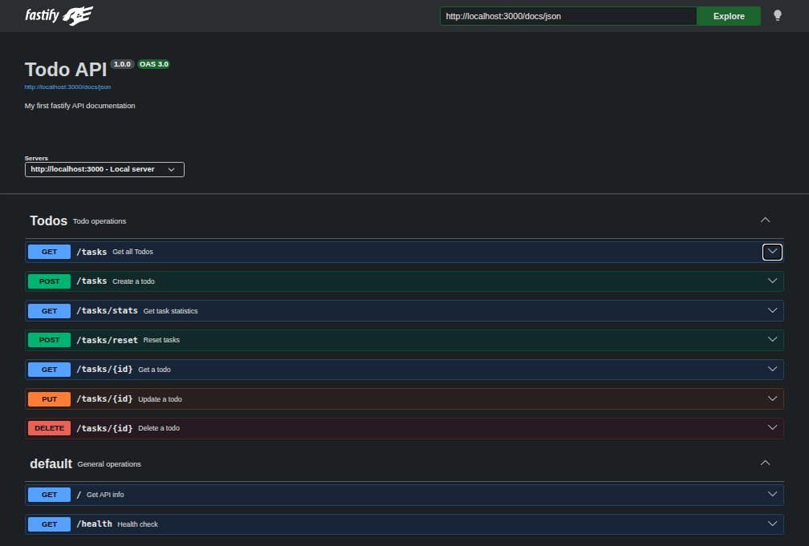

# Todo API

A lightweight **REST API** for managing todo tasks, built with [Fastify](https://fastify.dev/) and TypeScript. It ships with auto-generated **Swagger / OpenAPI docs** out of the box.

---

## What is this?

A CRUD API that lets you create, read, update, and delete todo tasks. Tasks are stored **in-memory** (no database required), so it's ready to run with zero configuration. The API exposes:

- A root info endpoint
- A health-check endpoint
- Full CRUD on `/tasks`
- Interactive Swagger UI at `/docs`

> [!WARNING]
> **Data does not persist across restarts.** Tasks live in RAM, so every time the server restarts it resets to the three built-in seed tasks below. Any tasks you created during the previous session will be gone.
>
> Default seed tasks on every fresh start:
> | id | title | done |
> |----|-------|------|
> | 1 | Complete Assignment 1 | false |
> | 2 | Complete Assignment 2 | false |
> | 3 | Complete Assignment 3 | false |

---

## Requirements

| Tool | Version |
|------|---------|
| Node.js | ≥ 18 |
| pnpm | ≥ 8 |

---

## Install & Run

One command — clone, install, build, and start:

```bash
git clone https://github.com/Raqibreyaz/Todo-App.git && \
  cd Todo-App && \
  pnpm install && \
  pnpm build && \
  pnpm start
```

The server starts on **http://localhost:3000**.  
Interactive docs are at **http://localhost:3000/docs**.

> **Tip:** For development with hot-reload, use `pnpm dev` after building once.

---

## Endpoints

| Method | Path | Description | Request Body | Success |
|--------|------|-------------|--------------|---------|
| `GET` | `/` | API info & available endpoints | — | `200` |
| `GET` | `/health` | Health check | — | `200 { status: "OK" }` |
| `GET` | `/tasks` | List all todos | — | `200 Task[]` |
| `GET` | `/tasks/:id` | Get a single todo by ID | — | `200 Task` |
| `POST` | `/tasks` | Create a new todo | `{ "title": string }` | `201 Task` |
| `PUT` | `/tasks/:id` | Update title and/or done status | `{ "title"?: string, "done"?: boolean }` | `200 Task` |
| `DELETE` | `/tasks/:id` | Delete a todo by ID | — | `204 No Content` |

### Task schema

```json
{
  "id":    1,
  "title": "Complete Assignment 1",
  "done":  false
}
```

---

## curl -i Example

```
$ curl -i -X PUT http://localhost:3000/tasks/3 \
    -H "Content-Type: application/json" \
    -d '{"title":"Bring Milk","done":true}'

HTTP/1.1 200 OK
content-type: application/json; charset=utf-8
content-length: 41
Date: Tue, 27 Oct 2026 19:52:28 GMT
Connection: keep-alive
Keep-Alive: timeout=72

{"id":3,"title":"Bring Milk","done":true}
```

Other quick examples:

```bash
# List all tasks
curl -i http://localhost:3000/tasks

# Create a task
curl -i -X POST http://localhost:3000/tasks \
  -H "Content-Type: application/json" \
  -d '{"title":"Buy groceries"}'

# Delete task 2
curl -i -X DELETE http://localhost:3000/tasks/2
```

---

## Swagger UI

Interactive API documentation is auto-generated and available at:

```
http://localhost:3000/docs
```



---

## Project Structure

```
Todo-App/
├── app.ts            # Entry point — registers Swagger & routes
├── src/
│   └── routes/
│       └── tasks.ts  # All /tasks CRUD handlers + OpenAPI schemas
├── tsconfig.json
└── package.json
```

---

## AI vs Me

### Prompt

- use the ai-version directory
- do not read the src directory to see my code, write your own code
- all dependencies are already installed
- use typescript
- create a todo app in fastify
- use in-memory data structure for the todo storage
- todo => {id: number, title: string, done: boolean}
- it should support operations like getting all todos, getting a single todo, adding a new todo, updating a todo, deleting a todo
- '/' endpoint should return a json showing api version, endpoints list, name of the server api
- /health should return a 200 "OK"
- initially there will be 3 pre existing todos
- POST /tasks/reset should reset all the todos with the initial 3
- deleting the todo just delete it but return no content, if todo doesn't exist then 404
- updating the todo can update any value provided in the body, if nothing to update then return 'bad request' response, PUT method will be here
- get a todo will just fetch and return that todo if not found return 404
- creating todo just takes a required 'title' and creates it with done: false
- getting all todos returns all the todos, it also filters the tasks according to query params,  searches tasks title containing 'search' string, searches tasks having done 'done'
- /tasks/stats returns json showing total, done, open no of tasks
- give proper schema to each route for request validation and response structure, tagging each route into their respective groups
- use swagger and swagger UI for interactive api testing in browser at /docs
- start the server at port 3000

---

### Comparison & Reflection

#### What did the AI do better — and do you understand its version well enough to explain it?

- **Architecture & Modularity:**
  - Created a dedicated `types.ts` file for all types, centralizing them in one place to increase modularity and reusability.
  - Created separate, standalone `readonly` schemas for request validation and response structure per route in a dedicated file to reduce main code verbosity.
  - Separated route registration and server startup into distinct functions.
  - Encapsulated task CRUD operations within a dedicated class where the tasks list is private and accessed/manipulated strictly via class methods.

- **Route Handling & Edge Cases:**
  - **Root (`/`) Endpoint:** Returns all available endpoints with their corresponding HTTP methods, whereas my version only returned `/tasks` without HTTP method information.
  - **Health Check (`/health`):** Conditionally returns JSON or plain text based on what the client accepts (via `Accept` header), whereas my version returned only plain text.
  - **Parsing & Validation:** In addition to schema validation, the AI handled explicit boolean parsing logic for query/body parameters, and added explicit `undefined` checks for incoming client data.
  - **Search:** Performed case-insensitive search on task titles, whereas my implementation was case-sensitive.

- **Comprehension:**
  - Yes, I understand and can explain the AI version well, except for some of the advanced configuration options used for Fastify and Swagger/Swagger UI.

#### What did it get wrong or quietly ignore from your prompt? (A missing 400 ? A wrong status code? A database you never asked for?)

- It did not get anything wrong or ignore requirements from the prompt.
- However, it added boilerplate and patterns I wouldn't typically write, such as adding direct-execution/main file checks before starting the server.

#### What did your prompt forget to specify — and what did the AI silently decide for you?

- **Export vs. Direct Run:** Handled the case of not starting the server when the file is imported elsewhere (exporting the server instance rather than immediately listening on the port).
- **Advanced Configuration Flags:** Silently configured several advanced framework settings that were not mentioned in the prompt, including app options (`routerOptions`, `ajv`), Swagger definitions (`servers`, `tags`), and Swagger UI settings (`uiConfig`, `staticCSP`, `transformStaticCSP`).

---

## License

ISC